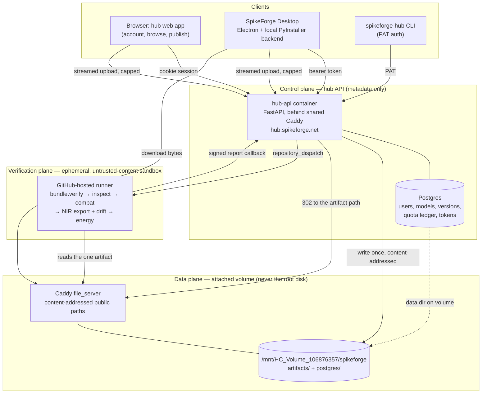

# Hub accounts, quotas, and community uploads — architecture

**Audience:** the engineer or agent implementing this, in a fresh session, with
no memory of the conversation that produced it. Everything needed is either
here or named by file and line.

**Goal:** let a person sign up at spikeforge.net, sign in from the desktop
app, get a bounded amount of hosted storage, publish an SNN they trained to
the SpikeForge hub, and download someone else's — without weakening a single
honesty guarantee the curated catalog already makes, and without putting a
single user byte on the production host's full root disk.

**Read first:**
[`spikeforge_hub/CURATION.md`](https://github.com/Capsize-Games/spikeforge/blob/main/spikeforge_hub/CURATION.md)
is the policy governing the *curated* catalog. This plan does not amend it and
does not add a single uploaded artifact to it. Uploads live in a separate
namespace with a separate policy (§6). Where this plan and `CURATION.md`
appear to disagree about the curated catalog, that document wins and this plan
is wrong.

**Implementation status (2026-09-16).** P1-P3 are built in
[`spikeforge-hub-api`](https://github.com/capsize-games/spikeforge-hub-api):
identity, per-account quotas, the two-phase upload, the community namespace and
its index. The identity primitives come from
[`capsize-auth`](https://github.com/capsize-games/capsize-auth). Four decisions
in this document were settled differently during implementation and the
sections below record what was actually chosen; §14 lists what is still open.
P4 (verification) and P5 (desktop sign-in endpoints) are not built.

**As-shipped record (2026-10-13).** This document first landed on the
`automation/pipeline` branch and was restored to `main` to close issue #85;
every `hub_accounts_plan` pointer in this repository and in
`spikeforge-hub-api` resolves here. P4 has since shipped on both sides — the
sandbox runner in this repository (`scripts/hub_verify/`,
`.github/workflows/hub-verify.yml`) and the dispatch plus signed-callback
endpoints in `spikeforge-hub-api` — with the exact reconciled contract pinned
in §7.3. P5's hub-side endpoints (loopback PKCE, device code, PATs, session
revocation) and the PAT-based CLI (`login`, `whoami`, `push`, `pull`,
`quota`) have shipped; the desktop-app keyring and sign-in UI live in
`spikeforge-dashboard` and are outside this record. Where a dated
"as-shipped"/"as built" note below disagrees with the original design text,
the note describes what the merged code does and the design text describes
what was first recommended.

---

## 0. Deployment constraints, before anything is designed

Four measured facts about the current deployment shape the whole architecture.
Each was checked on the host rather than assumed, and two of them rule out an
implementation that would otherwise look obvious.

### 0.1 🔴 The root disk is full; the attached volume is where data goes

Measured on `188.245.220.130` (the shared box described in the operator's
notes) on 2026-09-16:

```
Filesystem  Size  Used Avail Use% Mounted on
/dev/sda1    38G   35G  848M  98% /
/dev/sdb     49G   14G   34G  29% /mnt/HC_Volume_106876357
Mem:  3 GB total, ~1 GB available
Docker: 12.41 GB images, 7.21 GB build cache, data root /var/lib/docker
```

Two storage pools with opposite situations, and the distinction drives most of
this plan:

- **Root disk `/dev/sda1`: 848 MB free of 38 GB (98% full).** Shared with
  airunner/UwU Chat, audiovisualizer, fastsearch, floodit, the Capsize web
  platform, and WXRQ. Docker's data root is still here
  (`docker info` → `/var/lib/docker`), so **every image build draws on these
  848 MB**. The deployment workflow already knows this is fragile — it has a
  step named "Report disk capacity without deleting other services' images"
  (`.github/workflows/deploy-hetzner.yml`).
- **Hetzner Cloud Volume `/dev/sdb`: 33 GB free of 49 GB**, mounted at
  `/mnt/HC_Volume_106876357` (`/etc/fstab`, `nofail,discard`). It holds one
  thing today: `wxrq/video` at 14 GB. This is real, network-attached,
  snapshottable capacity, and it is resizable upward without moving the data.

Consequences:

- **Persistent data — artifact bytes and the Postgres data directory — live
  on the volume, never on the root disk.** WXRQ already establishes the
  convention: an absolute bind mount of `/mnt/HC_Volume_106876357/<project>/…`
  into the container (`/opt/wxrq/compose.yaml:95`). Hub paths follow it as
  `/mnt/HC_Volume_106876357/spikeforge/{artifacts,postgres}`.
- **33 GB of volume changes the storage recommendation.** Self-hosting the
  artifact bytes is viable at this project's scale — at the observed
  46 KB–414 KB per artifact (§1), 10 GB is tens of thousands of models.
  §5.2 recommends this over a third-party bucket for v1, behind an adapter so
  the decision stays reversible.
- **The hub must cap its own total footprint** (proposed 10 GB, §5.2),
  independently of per-user quotas. The volume's other tenant is a *growing*
  video library; a hub that fills the volume takes WXRQ down with it. This is
  the one shared-resource risk the design has to own explicitly.
- **Root-disk pressure is still a P0 blocker**, because builds and container
  layers land there regardless of where data goes. ~7.2 GB of reclaimable
  Docker build cache is the immediate breathing room (`docker builder prune`);
  relocating Docker's data root onto the volume is the durable fix. Adding a
  service to a root disk at 98% without doing one of the two will fail at
  build time.
- **No verification, training, or model loading for community content runs on
  this host** — that is about RAM and untrusted code, not disk, and the volume
  does not change it. See §7.

### 0.2 spikeforge.net is GitHub Pages and cannot run auth

`landing/CNAME` contains `spikeforge.net`, and the apex resolves to GitHub
Pages (`185.199.108–111.153`). The static landing page plus the rendered hub
page (`scripts/build_hub_page.py` → `spikeforge.net/hub/`) are published from
`landing/`. There is no server-side execution at the apex, so signup, login,
sessions, and cookies cannot be served from it as it stands. §3.4 gives the
two ways to satisfy "signup and login at spikeforge.net" and recommends one.

### 0.3 The hosted dashboard is single-tenant by design, and must stay that way

`dash.spikeforge.net` runs the FastAPI app in `server/` behind one shared
secret:

- `server/auth.py` — one process-wide `SPIKEFORGE_DASHBOARD_TOKEN`, compared
  with `hmac.compare_digest`. It is an operator gate, not an identity. Everyone
  who has it is the same principal.
- `server/app.py:31` — `_sessions: Dict[int, Session]`, one `Session` per
  socket, but every session shares one `MODEL_DIR`, one `HUB_CACHE_DIR`, one
  filesystem, one process, and one 3 GB RAM budget
  (`spikeforge/config.py:24-38`).
- Multi-user sessions and authentication are recorded as **explicitly
  deferred** in `plans/operations_plan.md:205` and
  `plans/professional_roadmap.md:420,493`.

So "log in" must not be read as "make the hosted dashboard multi-tenant." The
hosted dashboard runs *training* on a 3 GB shared box; turning it into a
per-user compute service is a different, much larger project with a real
hosting bill. This plan gives the hosted dashboard hub **identity and
browse/download**, and puts **publishing** where the user's models actually
live — the desktop app and the CLI. §8.3 states the consequence honestly and
§13 keeps per-user server-side storage as a later, optional phase.

### 0.4 The desktop app is already fully local — login is only for the hub

`spikeforge-dashboard`'s Electron main process spawns a **packaged PyInstaller
backend on 127.0.0.1** and points it at a per-user data directory
(`desktop/main.cjs`, `spawnBackend()`):

```js
SPIKEFORGE_DATA_DIR: path.join(app.getPath("userData"), "data")
```

Training, encoding, NIR export, and the model store are all local, on the
user's own hardware, with no account needed. This is the good news in the
whole design: **the desktop app needs an account for exactly one thing —
talking to the hub.** No session affinity, no server-side compute, no
remote-execution security model. A hub token is all it needs.

---

## 1. What exists today that this builds on

| Piece | Where | What it gives us |
|---|---|---|
| Portable artifact format | `spikeforge/serving/bundle.py`, `bundle_manifest.py` | `.spkf` — a zip holding `manifest.json`, `weights.pt`, `encode_config.json`, `preprocessing.json`, optional `graph.nir.json`, and `SHA256SUMS`. Build, verify, and load already exist. **This is the upload unit; no new format is needed.** |
| Bundle HTTP route | `server/bundle_routes.py` | `GET /api/bundle/{name}` builds a saved checkpoint into a `.spkf` and returns it. The upload flow reads bytes from here. |
| Catalog schema + validator | `spikeforge_hub/entry.py:112-141`, `spikeforge_hub/catalog.py` | `HubEntry` with `license`, `dataset_license`, `dataset_attribution`, `size_bytes`, `topology`, `test_accuracy`, `test_samples`. `load_catalog(path)` validates and **reports** bad entries rather than dropping them. A remote community index reuses this verbatim. |
| Download + verify + cache | `spikeforge_hub/downloads.py`, `verify.py`, `cache.py` | Child-process download worker with progress and cancel, sha256+size verification, cache layout, and `cache.dir_bytes()` / `entry_bytes()` size accounting. |
| Import funnel | `spikeforge_hub/import_model.py`, `inspect.py`, `compat.py`, `weight_map.py` | inspect → compat verdict (`exact`/`mappable`/`incompatible`) → promote with drift check. This is what makes a community download *useful* rather than just a file. |
| Hub UI | `spikeforge-dashboard/src/components/HubPanel.tsx`, `HubEntryCard.tsx`, `HubCompatBadge.tsx`, `HubDownloadProgress.tsx`, `src/hubTypes.ts` | Browse, download, compat badges, progress. Publishing is the new direction; browsing already has a home. |
| Hub WS protocol | `server/hub_handlers.py`, `hub_messages.py`, `hub_payloads.py` | `hub_list`, `hub_search`, `hub_download_state`, `hub_inspect`, `hub_import`. Versioned via `PROTOCOL_MAJOR` (`server/app.py:47-66`). |
| Governance registry | `spikeforge_hub/registry.py` | `dev → staging → prod` promotion, recorded approver, HMAC-signed entries, lineage. Local today; its vocabulary is what the hosted service's moderation states should mirror. |
| CI + deploy | `.github/workflows/deploy-hetzner.yml`, `docker-compose.hetzner.yml` | rsync + `docker compose up --build` behind the shared `uwu_shared` Caddy network, `.env` from the `SPIKEFORGE_ENV_FILE` secret, health check. A second service follows the same pattern. |

And what does **not** exist: any database (no `sqlite`, `sqlalchemy`,
`psycopg`, or `asyncpg` anywhere in the tree), any notion of a user, any
upload path, any object storage, and any email sending.

**Artifact sizes, measured** — every entry in today's catalog:

| Artifact | Bytes |
|---|---|
| `mnist-conv-net.pt` | 46,293 |
| `mnist-fc-small.pt` | 109,117 |
| `mnist-recurrent-net.pt` | 229,645 |
| `mnist-fc-legacy.pt` / `fashion-` / `kmnist-` | ~414,000 each |

Between 46 KB and 414 KB. This matters for §5: **storage is not the scarce
resource; egress and moderation attention are.** A quota's job here is abuse
control, not cost control.

---

## 2. The shape of the system

Three planes, deliberately separated because they have different trust levels,
different failure modes, and different hardware needs.



**Why the hub API is a new service and not a few routes bolted onto
`server/`:**

1. `server/` is single-tenant by design and documented as such (§0.3). Adding
   identity to it contradicts its own invariants.
2. The hub must stay up while the dashboard restarts, rebuilds, or OOMs.
   Publishing should not fail because someone's training job ate the box.
3. Different dependency surface: the hub API needs no `torch`. The dashboard
   image is a multi-GB PyTorch install; the hub API should be tens of MB. On
   a disk at 98%, that difference is the difference between shipping and not.
4. Different trust boundary: the hub API handles credentials and other
   people's content. Keeping it out of the process that runs `torch.load` on
   user-selected files is basic hygiene.

**Repository:** a new `capsize-games/spikeforge-hub-api` repo, following
ARCH-0001's naming (`plans/arch-0001-target-topology.md`). It is a *service*,
not a distribution — nothing `pip install`s it. The client half ships inside
the existing `spikeforge-hub` distribution as `spikeforge_hub/client.py` (§8).
Note: repository creation and branch protection must be done by the operator;
this environment cannot administer the org's repos.

---

## 3. Identity and authentication

### 3.1 Decided: email and password, plus any OAuth2 provider

**Decided: email with a password *and* a pluggable set of OAuth2 providers**,
so people have more than one way in. What follows was the original
recommendation and the reasoning that overturned it; it is kept because the
tradeoff is still the one to re-read before adding a provider.

The recommendation below was built on avoiding a password stack. That argument
collapsed when an existing one turned up: `uwuchat-auth-core`, extracted from
UwUChat, already had argon2id hashing with a constant-time dummy verify,
a zxcvbn strength policy, and reset tokens, all tested. Generalised and
published as
[`capsize-auth`](https://github.com/capsize-games/capsize-auth), it supplies
the password layer, a generic authorization-code flow driven from provider
descriptions, PKCE, and the token primitives.

So the cost of email and password is now only what it always really was:
**a transactional email provider**, for verification and reset delivery, which
`capsize-auth` deliberately does not do. That remains unprovisioned and is a
launch blocker for the password route — an account cannot publish until its
address is proven, and nothing can prove one until mail sends.

Provider links live in their own table rather than as a column per provider,
which is what makes "any provider we are allowed to implement" configuration
rather than a migration. Presets ship for GitHub, Google, GitLab, Discord,
Twitch, Microsoft and ORCID; a deployment offers only those it registers
credentials for, so a sign-in page renders exactly the buttons that work.

**The original recommendation: GitHub OAuth as the only identity provider**,
with email/password deferred until there is evidence it is needed.

What this avoids, permanently or for now: password hashing and rotation
policy, credential-stuffing defence, password reset flows, an SMTP provider
and its deliverability problem, email-verification bounce handling, and the
bulk of bot signups. What it gives: a verified email, an avatar, a stable
account id, a username that seeds the hub namespace (`@handle/model`), and —
critically — **a device flow we can lean on for the desktop app**.

The audience fits: the people who publish SNN checkpoints have GitHub
accounts, and the project already lives there (issues, wiki, releases,
`CONTRIBUTING.md`).

The cost, stated plainly: someone without a GitHub account cannot sign up. If
that is unacceptable, the fallback is **email + password with argon2id**, a
transactional email provider, and the full reset/verification surface — a
substantial addition with a recurring operational burden (see §14, Q1). A
middle option is adding a second OAuth provider (Google, ORCID — ORCID is
worth considering for an academic audience) rather than building passwords.

Whichever is chosen, the hub API is the **authorization server** for its own
tokens. Identity is delegated; authorization is not. Clients never see a
GitHub token.

### 3.2 Web session

- `GET /login` → redirect to the provider with PKCE and `state`.
- `GET /oauth/callback` → exchange code, upsert `users` row, create a session.
- Session cookie: `__Host-sfh_session`, `HttpOnly`, `Secure`,
  `SameSite=Lax`, path `/`, opaque 256-bit random id, server-side record with
  absolute expiry (30 days) and idle expiry (7 days). **Not a JWT** — sessions
  must be revocable on sign-out and on account deletion, and a stateful table
  is simpler than a revocation list.
- CSRF: `SameSite=Lax` plus a double-submit token on every state-changing
  form, because the hub web app and the API share an origin (§3.4).

### 3.3 Desktop and CLI tokens

Three token kinds, with distinct lifetimes:

| Kind | Format | Lifetime | Scope | Storage |
|---|---|---|---|---|
| Access token | opaque, `sfh_at_…` | 1 hour | request-scoped | memory only |
| Refresh token | opaque, `sfh_rt_…` | 90 days, rotating | mint access tokens | OS-encrypted at rest |
| Personal access token (PAT) | opaque, `sfh_pat_…` | user-chosen, revocable | `models:read`, `models:write` | user's own secret store / CI secret |

Only a hash is stored server-side (SHA-256 for the high-entropy opaque
tokens; these are not passwords, so a slow KDF buys nothing). The plaintext is
shown once at creation. Refresh rotation detects theft: presenting a rotated
refresh token invalidates the whole chain.

**Desktop login flow — recommended: loopback PKCE (RFC 8252).**

1. Electron main reserves an ephemeral port on 127.0.0.1 (the codebase
   already has `reservePort()` in `desktop/main_helpers.cjs`) and starts a
   one-shot HTTP listener.
2. It opens the **system browser** — never an in-app `BrowserWindow`, so the
   user authenticates on a URL bar they can inspect — at
   `https://hub.spikeforge.net/oauth/authorize?...&redirect_uri=http://127.0.0.1:<port>/callback`
   with a PKCE `code_challenge` and a random `state`.
3. The user signs in (or signs up — the same page) and approves.
4. The browser is redirected to the loopback listener with `code`; main
   exchanges it for an access + refresh token over TLS, then shuts the
   listener down.
5. Tokens go to disk via Electron's built-in `safeStorage.encryptString`
   (no native dependency), in `app.getPath("userData")`, mode `0600`.

**Fallbacks, both needed:**

- **Device authorization flow (RFC 8628)** — `POST /oauth/device_code`
  returns a short user code; the app shows "go to
  hub.spikeforge.net/activate and enter `WXYZ-1234`" and polls. Required for
  the case where loopback fails: a remote/SSH session, a hardened Linux
  desktop with no browser handler, or a locked-down corporate machine.
- **Paste a PAT** — always available, and the only option for CI and
  headless scripts.

**Linux keyring caveat, stated because it will bite:** `safeStorage` on Linux
needs an available secret service (`gnome-libsecret`/`kwallet`). The AppImage
target (`electron-builder.yml`) will run on machines without one. Behaviour
when `safeStorage.isEncryptionAvailable()` is false: **do not silently write
a plaintext refresh token.** Keep the session in memory for the run, tell the
user their sign-in will not persist, and offer a PAT as the persistent
alternative. A plaintext long-lived credential written without consent is the
kind of thing this project should not ship.

Sign-up from the desktop app needs no extra work under this design: step 2's
page carries both, so the user never leaves the flow. The "signup goes to the
website" fallback is what happens naturally if the browser hand-off fails.

### 3.4 Hostnames and where the account UI lives

| Host | Serves | Where |
|---|---|---|
| `spikeforge.net` | landing (17 locales) + static `/hub/` catalog page | GitHub Pages, unchanged |
| `hub.spikeforge.net` | hub web app **and** its API, same origin | new container, shared Caddy on the VPS |
| `cdn.spikeforge.net` | published artifact bytes | shared Caddy, served from the volume (§5.2) |
| `dash.spikeforge.net` | hosted dashboard | unchanged |
| `docs.spikeforge.net` | wiki redirect | unchanged |

**Recommended: `hub.spikeforge.net` for the account UI and API on one
origin.** The landing page gets a "Sign in" link. Single-origin keeps cookies
simple (`__Host-` prefix works, no cross-site CORS credentials, no CORS
preflight on every state-changing call), and it leaves the free-CDN static
landing page untouched on a host whose disk is full.

The alternative, if "at spikeforge.net" must be literal: put Cloudflare in
front of the apex and proxy `/account/*` and `/api/*` to the VPS while Pages
keeps the rest. It reads better in the URL bar and costs a second routing
layer, a second place a deploy can break, and CDN cache rules that must not
cache authenticated responses. Recommend `hub.` first; the apex path stays
available later without changing the API.

---

## 4. Data model

Postgres, in a container on the shared network, once disk is reclaimed
(§0.1). SQLite+WAL would genuinely work at this scale and would cost no
RAM — but quota reservation is a concurrent read-modify-write, the CI callback
writes while the API serves, and migrating a live user table later is
unpleasant. Postgres idles at tens of MB; take it now.

```
users
  id              uuid pk
  handle          citext unique      -- namespace: @handle/model
  email           citext unique      -- from the provider, for notices only
  display_name    text
  provider        text               -- 'github'
  provider_id     text               -- unique with provider
  storage_limit   bigint             -- per-user override of the default
  state           text               -- active | suspended | deleted
  created_at, updated_at timestamptz

sessions        id, user_id, created_at, last_seen_at, expires_at, ua, ip_hash
tokens          id, user_id, kind, hash, name, scopes[], expires_at,
                revoked_at, last_used_at, chain_id  -- refresh rotation

models
  id              uuid pk
  owner_id        uuid -> users
  slug            text               -- unique per owner; reserved list applies
  visibility      text               -- public | private
  license         text               -- SPDX id, entry.py's vocabulary
  dataset         text
  dataset_license text
  dataset_attribution text
  summary, description text
  state           text               -- active | hidden | takedown
  created_at, updated_at

model_versions
  id              uuid pk
  model_id        uuid -> models
  version         text               -- semver-ish, immutable once published
  sha256          char(64)           -- of the .spkf
  size_bytes      bigint
  object_key      text               -- artifacts/{model_id}/{version}.spkf
  state           text               -- reserved | uploaded | verifying
                                     -- | published | rejected | deleted
  manifest        jsonb              -- extracted from the bundle manifest
  verification    jsonb              -- report from the sandbox (§7)
  download_count  bigint
  published_at, created_at, expires_at

quota_ledger    -- append-only; the balance is derived, never edited in place
  id, user_id, model_version_id, delta_bytes, reason, created_at
  -- reason: reserve | commit | release | delete | admin_adjust

audit_log       id, actor_id, action, subject, detail jsonb, created_at
```

Two deliberate choices:

- **`quota_ledger` is append-only.** A single mutable `bytes_used` column
  drifts the first time a commit races a delete, and then a user is stuck
  unable to upload with no way to see why. A ledger can be recomputed from
  the stored artifacts and reconciled; a counter cannot be audited.
- **As built, the ledger has no `reserve` reason.** It records only bytes
  actually stored, and pending bytes are derived from the `reserved`
  model-version rows, which already carry a size and an expiry. That removes
  the compensating `release` entry at commit time, and it means an abandoned
  upload stops counting against an allowance the moment it expires rather
  than when a janitor next runs — so a crashed request cannot leave a
  permanent charge behind. The janitor then only reclaims disk, and
  correctness does not depend on it having run.
- **`model_versions.manifest` is the bundle's own manifest, extracted
  server-side, never client-asserted.** The client sends a checksum and a
  size; everything descriptive comes from bytes we verified (§7). A client
  that claims 98% accuracy does not get to have that rendered as a fact.

---

## 5. Storage, quota, and the upload protocol

### 5.1 Two-phase upload, with the reservation done before bytes move

```mermaid
sequenceDiagram
  participant C as Client
  participant A as hub API
  participant O as Volume (artifacts/)
  participant V as Verify sandbox

  C->>A: POST /v1/uploads {model, version, sha256, size, license, ...}
  A->>A: quota check + reserve size_bytes (ledger)
  A->>A: dedup: same sha256 already stored?
  A->>A: volume headroom check (hub cap, free space)
  A-->>C: {upload_id, put_url, expires_at} or 409 duplicate / 413
  C->>A: PUT bytes (Content-Length pinned to the reservation)
  A->>O: stream to a temp file, hashing as it goes; never buffer in RAM
  A->>A: size or sha256 mismatch -> discard, release, 422
  A->>O: fsync + atomic rename to the content-addressed path
  C->>A: POST /v1/uploads/{id}/commit
  A->>A: state = verifying; ledger reserve -> commit
  A->>V: repository_dispatch
  V->>A: GET artifact via a signed, single-object, read-only URL
  V->>V: bundle.verify, inspect, compat, NIR export + drift, energy
  V->>A: POST /internal/v1/verifications/{id} (signed)
  A->>A: state = published | rejected; index invalidated
```

Details that matter:

- **The reservation happens before a single byte is accepted**, and the `PUT`
  is refused unless `Content-Length` equals the reserved size. The API enforces
  the cap *during* the stream as well and aborts past it, because
  `Content-Length` is a client claim. Without both halves, "reserve 2 MB,
  upload 2 GB" is trivially exploitable.
- **Bytes stream to disk, never into memory.** On a box with ~1 GB available
  RAM (§0.1) a buffered 256 MiB upload is an OOM that takes the other services
  with it. Write to a temp file on the *same* filesystem as the destination,
  hash while streaming, then `fsync` and atomically rename. A partially
  written artifact must never be reachable under its final name.
- **The hash is computed server-side and compared to the intent.** The client's
  claimed `sha256` is an assertion; the stored artifact's hash is the fact. A
  mismatch discards and releases.
- **Reservations expire** (15 minutes). A janitor releases expired
  reservations and deletes orphan temp files. Abandoned uploads must not
  permanently consume a user's quota — or the volume.
- **Content-addressed dedup.** Identical `sha256` across users stores one
  file; the ledger still charges each owner (simpler, and it keeps deletion
  from unsharing bytes under someone else). Reference-counted deletion.
- **Versions are immutable.** Republishing means a new version. This is what
  makes a pinned checksum meaningful — the same property `CURATION.md`
  already relies on for reference entries.
- **Downloads never pass through Python.** The API authorizes, then hands off
  to Caddy to serve the file. The app process must not be in the path of a
  file transfer it has no reason to touch.

  As built this is a 302 to a content-addressed path on `cdn.spikeforge.net`
  that Caddy serves straight off the volume, not an `X-Accel-Redirect`-style
  internal redirect: Caddy has no native equivalent. That is sufficient while
  every published artifact is public, and it is the specific thing that has to
  change before private models are possible (§14 Q6) — a signed path, or a
  Caddy module that can verify one.

  As shipped (2026-10-13), the verification sandbox (§7.3) fetches the same
  public content-addressed URL a published download redirects to — not a
  per-job signed URL. The object key is unguessable, so an unpublished
  version's bytes are no more exposed than a published one's.

### 5.2 Where the bytes live: the attached volume, behind an adapter

**Recommended for v1: the Hetzner Cloud Volume already on the box**
(`/mnt/HC_Volume_106876357/spikeforge/artifacts`, §0.1), served by the shared
Caddy, with an S3-compatible adapter written but unused.

Why the volume wins at this project's scale:

- **It exists and it is paid for.** 33 GB free today, on a network-attached,
  snapshottable volume that can be grown without moving the data. At the
  observed 46 KB–414 KB per artifact (§1), a 10 GB hub cap is tens of
  thousands of models.
- **No new vendor, no new credentials, no new failure mode.** No bucket
  policy, no key rotation, no CDN cache-invalidation story, no second invoice.
  For a one-person project that operational surface is a real cost, and it is
  the cost that gets skipped and then bites.
- **Server traffic is already bundled.** Egress from the box is part of the
  server's included traffic allowance rather than a per-GB line item, which
  removes the one axis that made a third-party bucket attractive.
- **Backups are a volume snapshot plus `pg_dump`** (§11), not a second
  replication design.

What the volume does **not** give, stated plainly: no CDN edge (downloads are
served from one machine in one region), no independent durability from the
rest of the box's operations, and no ability to absorb a traffic spike without
affecting the six other services behind the same Caddy. Those are the
conditions that should trigger the move to object storage, and they are
plausible if the hub succeeds.

So: **write the storage layer as an adapter from day one.** Two
implementations, one interface — `put(key, stream, expected_sha256, size)`,
`open(key)`, `delete(key)`, `stat(key)`, `signed_url(key, ttl)` — with
`SPIKEFORGE_HUB_STORAGE=volume|s3`. The two-phase reserve/commit protocol in
§5.1 is written so it works unchanged against a presigned-`PUT` backend: the
only difference is whether `put_url` points at our API or at a bucket. Moving
later is then a config change and a byte copy, not a redesign.

Layout on the volume:

```
/mnt/HC_Volume_106876357/spikeforge/
  artifacts/{sha256[0:2]}/{sha256}.spkf      # content-addressed, immutable
  reports/{model_version_id}/verification.json
  tmp/{upload_id}                            # same filesystem, atomic rename
  postgres/                                  # the database data directory
```

Content-addressed paths (rather than `{model}/{version}/`) make dedup free and
make the file name self-verifying; the human-readable mapping lives in
`model_versions.object_key`. Sharding on the first two hex characters keeps any
one directory small.

**Two hard limits the hub enforces on itself:**

- **A total hub footprint cap** (proposed **10 GB**), checked at upload intent
  and independent of per-user quotas. The volume's other tenant is WXRQ's
  *growing* video library (14 GB today); a hub that fills this volume takes
  WXRQ down with it. That is unacceptable and must be structurally impossible,
  not merely monitored.
- **A free-space floor** (refuse uploads below **5 GB** free on the volume,
  regardless of the cap), so a wrong cap or a wxrq growth spurt still cannot
  produce a full filesystem.

Neither the artifacts nor the Postgres data directory may live on `/` — see
§0.1. Both belong on the volume via the absolute bind mount WXRQ already
established (`/opt/wxrq/compose.yaml:95`).

### 5.3 The quota, with real numbers

Today's artifacts are 46 KB–414 KB (§1). A conv/event model with more
parameters, or a `.spkf` carrying an uncompressed state dict, will be larger,
but this is a kilobyte-to-megabyte domain, not a gigabyte one.

Per-account quotas sit *inside* the hub-wide footprint cap of §5.2, and the two
do different jobs: the per-account limit is fairness and abuse control, the
hub-wide cap is what protects the volume's other tenant. Overcommitting the
per-account limits is fine and expected — the hub-wide cap is the one that must
never be exceeded.

Proposed defaults, per account:

| Limit | Default | Why |
|---|---|---|
| Total stored bytes | **1 GiB** | Thousands of artifacts at observed sizes. Generous without being a free file host, and 10 accounts at the limit still fit inside the hub's own 10 GB cap (§5.2). |
| Single artifact | **256 MiB** | Room for a much larger model than anything shipped; well under anything worth abusing. |
| Models | **50** | Namespace hygiene. |
| Versions per model | **20** | Keeps history without unbounded growth. |
| Uploads per day | **50** | Rate control, independent of bytes. |
| Total egress per account per day | **10 GiB** | Not a billing control — server traffic is bundled (§5.2) — but a fairness control: downloads are served from the same box as six other services. |

`storage_limit` is a per-user column so a research group can be raised without
a deploy. Quota is enforced at **intent** (before bytes move) and reconciled
at **commit**. A 413 must say which limit was hit and what the current usage
is — a quota error that does not name the number is a support ticket.

As shipped (2026-10-13): the per-day egress ceiling in the table above
exists in this document only — the service keeps no egress counter
(downloads redirect to the CDN, so the API never sees the bytes) and
enforces nothing here. Every other number above is a default in
`hub_api/config.py`.

Reuse `spikeforge_hub/cache.py`'s `dir_bytes()`/`entry_bytes()` vocabulary on
the client side so the desktop app can show local cache usage next to hosted
usage; they are different pools and the UI must not blur them.

---

## 6. Namespace and trust model — the part most likely to be got wrong

The curated catalog's entire value is that **every claim in it has been
checked** (`CURATION.md`: "An invented repository id or an unnamed license is a
fabrication and must never be committed here"). Community uploads are, by
definition, claims nobody on this project has checked. Mixing them destroys
the guarantee that makes the hub worth having.

So:

| | Curated | Community |
|---|---|---|
| Ids | `reference/mnist-fc-small`, `nir/conv_net` | `@handle/model-slug` |
| `source` | `reference`, `bundled` | **`community`** (new) |
| Ships in the wheel | yes, `spikeforge_hub/models.json` | never |
| Distribution | inside `spikeforge-hub` | hosted index, fetched and cached |
| Policy | `CURATION.md` (unchanged) | new `COMMUNITY.md` |
| Accuracy numbers | reproduced by `scripts/train_reference_models.py` | **uploader's claim, labelled as such** |
| Trust label | `curated` | `machine-checked` or `unchecked` |

- **An upload is never promoted into `models.json`.** If the project wants a
  community model as a reference entry, that goes through `CURATION.md`'s
  process — retrained, re-measured, checksum-pinned by us.
- **The `@` prefix is what keeps the namespaces unambiguous** in a single list,
  a URL, and a CLI argument. Reserve `reference`, `nir`, `snntorch`, `norse`,
  `lava`, `spikingjelly`, `spikeforge`, `admin`, `api`, `hub`, and the existing
  curated prefixes as handles.
- **`machine-checked` is not `verified`.** It means: the bundle's checksums
  matched, it loaded with `weights_only=True`, it produced a NIR graph, the
  drift check passed, and an energy report was generated (§7). It does **not**
  mean the accuracy claim was reproduced, the license was read by a human, or
  the model is any good. The badge copy must say so — the existing hub page
  already carries a "metadata-only" honesty notice and this is the same
  obligation. `HubCompatBadge.tsx` is the component that grows a trust variant;
  `COPY_POLICY.md` governs the words on it.
- **License is mandatory at upload** and validated against the same vocabulary
  as `HubEntry` (`entry.py:229` — a concrete SPDX-style id or the explicit
  `unverified-candidate` marker; free text rejected). `dataset_license` and
  `dataset_attribution` follow the existing split: the weights' license is not
  the data's license (`documentation/model-hub.md`).

**Offline clients reuse the existing loader.** The hosted index is served as
`GET /v1/index.json` in the *exact* schema `spikeforge_hub/catalog.py`
already validates (`version: 1`, `entries: [...]`), with `source: "community"`.
The client fetches it with ETag caching into `HUB_CACHE_DIR`, then calls
`load_catalog()` on the cached file — so a malformed hosted entry is
*reported* through `issues()` exactly like a malformed bundled one, and the
whole catalog still renders offline. No second validation path, no second
schema.

As shipped (2026-10-13): the label rule is
`hub_api/catalog/trust.py::label_for` — `machine-checked` if and only if the
version is `published` and its stored report has `"passed": true`, else
`unchecked`. Index entries also carry the service-measured `sha256` digest,
so a pull checksum-verifies the download the way direct-URL downloads
already do.

---

## 7. Verification: the differentiator, and the sandbox it must run in

### 7.1 Why it exists

Anyone can host `.pt` files. What SpikeForge can do that Hugging Face cannot
is tell you, before you download, whether an artifact **exports to NIR,
survives a drift check against the reference interpreter, maps onto a known
topology, and what it costs in SOP/MAC/AC**. Every one of those tools already
exists in this repo (`spikeforge_hub/inspect.py`, `compat.py`,
`spikeforge_targets/energy/`, the reference interpreter behind invariant 4 in
`rules.md`). Running them on upload turns a file host into the honest hub the
roadmap describes.

Pipeline on each new version:

1. `bundle.verify` — `SHA256SUMS`, manifest shape, required entries
   (`bundle_manifest.REQUIRED_ENTRIES`).
2. `torch.load(..., weights_only=True)` — already how `bundle.py:68-76` loads
   weights. **Non-negotiable for community content.**
3. `inspect` → artifact kind and structure.
4. `compat` → `exact` / `mappable` / `incompatible` against shipped presets.
5. NIR export + drift check against the reference interpreter.
6. Deployment report + energy estimate.
7. Post a signed report; set `published` or `rejected` with named reasons.

The report is attached to the listing and to `verification.json` in storage.
A rejection must name what failed, in the uploader's words — "weights are not
loadable" is actionable, "verification failed" is not.

### 7.2 Where it runs, and the trap to avoid

**Run it on GitHub-hosted ephemeral runners, triggered by
`repository_dispatch`.**

- Not on the VPS: no disk, no RAM, and it would put `torch.load` on
  user-supplied bytes inside the box that holds the credentials for six other
  projects.
- **Not on the existing self-hosted `spikeforge-ci` runner.** That runner is
  used by `deploy-hetzner.yml` and holds the Hetzner deploy key. Executing
  untrusted content on a persistent self-hosted runner is how a self-hosted
  runner becomes an attacker's shell — it is the single most predictable way
  this design could be compromised. GitHub-hosted runners are fresh VMs,
  thrown away after each job, and have the CPU and disk this needs.

The runner gets a **read-only, key-scoped, short-lived** credential for just
that one object, and an HMAC-signed callback token valid for one report. It
never gets a credential that reaches any other artifact, or any write path.

Additional guards inside the sandbox: a decompressed-size cap before reading
zip members (`bundle.py:193-200` reads members into memory — a zip bomb is
otherwise a runner OOM rather than a rejection), a wall-clock timeout, and no
network egress beyond the two endpoints it needs.

### 7.3 The as-shipped verification contract (P4)

Shipped 2026-10-13 on both sides: the trigger and callback in
`spikeforge-hub-api` (`hub_api/uploads/dispatch.py`,
`hub_api/routes/verifications.py`, `hub_api/schemas/verifications.py`,
`hub_api/uploads/verify.py`) and the runner here
(`scripts/hub_verify/`, `.github/workflows/hub-verify.yml`). The two halves
were aligned after landing (`spikeforge-hub-api` `0632a5e`); what follows is
the reconciled contract, and on any disagreement the code cited here wins.

Dispatch (hub API → GitHub). When a commit moves a version into `verifying`,
the API fires a `repository_dispatch` at the repo named by
`verification_dispatch_repo` (empty by default, which disables the trigger).
Event and payload:

- `event_type`: `hub-artifact-verify` (`verification_dispatch_event`).
- `client_payload`: `version_id` (uuid string), `sha256` (hex),
  `object_key`, `artifact_url` (the public content-addressed download URL),
  `callback_url` (informational — the runner does not trust it; see below).

Runner. `hub-verify.yml` listens for `hub-artifact-verify`, runs on
`ubuntu-latest` (never self-hosted, 20-minute ceiling), and calls
`python -m hub_verify.cli` with `version_id` and `artifact_url` from the
payload. The callback base URL is the repository variable
`SPIKEFORGE_HUB_API_BASE_URL`, never the payload's `callback_url` — the
destination is configured, not dispatched. Checks run in
bundle → inspect → compat → drift → energy order and stop at the first
failure, whose message becomes the rejection reason.

Callback (runner → hub API).
`POST /internal/v1/verifications/{version_id}`:

- Header `X-Spikeforge-Hub-Signature: sha256=<hex>` — HMAC-SHA256 over the
  exact request-body bytes, keyed with the shared `verification_secret`
  (`hub_verify/signing.py::sign_body`, byte-identical to
  `hub_api/auth/signatures.py::sign`).
- Body: `{"passed": bool, "reasons": [str, ...], ...}` — `reasons` names each
  failing step in the uploader's words and is required non-empty when
  `passed` is false (`"verification failed"` alone is refused); every other
  field is carried through verbatim (`extra="allow"`) and needs no hub-side
  change. The runner sends `version_id`, `passed`, `reasons`, `checks`
  (bundle/inspect/compat/drift/energy detail), `summary`, `generated_at`,
  and `runner` (workflow + run URL).
- Identity: the runner also sends top-level `framework`, `kind`,
  `topology`, and `input_shape`, measured from the bytes — never from
  uploader claims. `framework` is the runner's own assertion (`spikeforge`:
  it only verifies `.spkf` bundles, whose load enforces that format);
  `kind` is what the inspect step found; `topology` names the spec the
  runner loaded, built, and drift-checked; `input_shape` is the trailing
  probe dimensions of the exact tensor the drift check consumed (e.g.
  `1x28x28`, `784`). The four keys are always present and null whenever
  the run fails before the funnel completes. The hub side renders them
  verbatim into the index entry (`hub_api/catalog/index.py::entry_for`),
  so a machine-checked upload shows its real topology and kind.
- Effect (`apply_report`): `passed` → `published` (stamped
  `published_at`); failed → `rejected`; the report is stored verbatim in
  `version.verification` either way. Only a version in `verifying` can
  receive a report.

---

## 8. Client integration

### 8.1 Where the token lives, and where bytes flow

The rule that resolves every ambiguity: **metadata over HTTPS from the UI;
bytes handled by whichever side already has them on disk.**

- **Publishing from desktop:** the renderer holds the access token (obtained
  in main via §3.3, passed in over a `contextBridge` channel), calls the hub
  API for the upload intent, fetches the `.spkf` from the *local* backend's
  existing `GET /api/bundle/{name}`, and streams it to the `put_url` the
  intent returned. The local Python backend never sees the hub token.
- **Downloading:** the bytes must land on disk where the import funnel can
  reach them, so this goes through the Python side —
  `spikeforge_hub/downloads.py`'s child-process worker gains a `community`
  source that resolves a signed URL and writes into `HUB_CACHE_DIR`, then the
  existing inspect → compat → promote funnel runs unchanged. The token is
  passed **per request** and never persisted by the backend.
- **CLI:** `spikeforge_hub/client.py` (new, in the existing distribution)
  wraps the API with PAT auth; `spikeforge_hub/cli.py` grows `login`,
  `whoami`, `push`, `pull`, and `quota`.

### 8.2 Protocol changes

The dashboard↔backend WebSocket protocol is versioned and schema-generated
(`plans/arch-0001-protocol-contract.md`; `PROTOCOL_MAJOR` gate at
`server/app.py:47-66`). New messages are additive — a MINOR bump, not MAJOR:

| Direction | Message | Purpose |
|---|---|---|
| → | `hub_pull` | download a community version into the cache |
| ← | `hub_pull_state` | progress/cancel, mirroring `hub_download_state` |
| → | `bundle_build` | build a `.spkf` for a saved model and report its path, size, sha256 |
| ← | `bundle_built` | the above, so the renderer can upload it |

Note `hub_list`/`hub_search` need **no** change: the community index is loaded
by the same `catalog.load_catalog()` path (§6), so it appears in the existing
payloads with `source: "community"`. `hubTypes.ts` grows the new `source`
value and the trust label; `HubPanel.tsx` grows a filter.

### 8.3 The hosted dashboard, honestly

On `dash.spikeforge.net` every visitor shares one `MODEL_DIR` (§0.3). So:

- **Sign-in and browse/download/import: yes.** Hub identity is per-socket,
  the token lives in the page, nothing is written to a shared location that
  identifies a user.
- **Publishing: not from the hosted dashboard in v1.** The saved models there
  are a shared pile; letting anyone publish from it means letting anyone
  publish anyone else's checkpoint, and the quota would be charged to whoever
  clicked. The UI should say exactly that and point at the desktop app and the
  CLI — not hide the button with no explanation.

Making the hosted dashboard genuinely per-user means per-user
`MODEL_DIR`/`HUB_CACHE_DIR` (today module-level constants in
`spikeforge/config.py:24-38`), per-user process or job isolation, and a
compute budget on a 3 GB shared box. That is phase 5 at the earliest, with a
hosting decision behind it, and it should not gate any of the above.

---

## 9. API surface (v1)

```
# identity
GET    /login                       -> provider redirect (PKCE)
GET    /oauth/callback              -> session cookie
POST   /logout
GET    /oauth/authorize             -> desktop loopback PKCE
POST   /oauth/token                 -> code | refresh_token grant
POST   /oauth/device_code           -> device flow start
GET    /activate                    -> device-code entry page
GET    /v1/me                       -> profile + quota {used, reserved, limit}
POST   /v1/tokens                   -> mint a PAT (plaintext shown once)
DELETE /v1/tokens/{id}

# discovery (public, cacheable)
GET    /v1/index.json               -> catalog-schema snapshot, ETag
GET    /v1/models?q=&framework=&task=&license=&sort=
GET    /v1/models/{handle}/{slug}
GET    /v1/models/{handle}/{slug}/versions/{version}
GET    /v1/models/{handle}/{slug}/versions/{version}/download  -> 302 signed

# publishing (authenticated)
POST   /v1/uploads                  -> intent: quota check, returns put_url
PUT    /v1/uploads/{id}/content     -> streamed bytes, Content-Length pinned
POST   /v1/uploads/{id}/commit
DELETE /v1/uploads/{id}             -> release reservation
PATCH  /v1/models/{handle}/{slug}   -> description, visibility, license
DELETE /v1/models/{handle}/{slug}/versions/{version}

# internal
POST   /internal/v1/verifications/{version_id}   -> HMAC-signed CI callback
GET    /health                                    -> matches server/app.py
```

Conventions: `Idempotency-Key` on `POST /v1/uploads` so a retried intent does
not double-reserve; RFC 9457 problem details on errors; cursor pagination;
`Retry-After` on 429.

As built (2026-10-13, `spikeforge-hub-api` main), the route table differs
from the sketch above in the identity half and matches it in the
community/publishing half:

- Identity ships as JSON endpoints under `/v1/auth/*` (`register`, `login`,
  `logout`, `refresh`, `verify`, `verify/resend`, `password/reset`,
  `password/reset/confirm`, `sessions/revoke-all`) plus external-provider
  brokering at `/oauth/{provider}/start|callback`; the hub's own
  loopback-PKCE grant is `GET /oauth/authorize` + `POST /oauth/token`, with
  `POST /oauth/device_code` and `GET /activate` as the device fallback
  (§3.3).
- `GET /v1/me` returns the profile plus a `storage` block (`used_bytes`,
  `reserved_bytes`, `limit_bytes`, `available_bytes`), a `limits` block (the
  §5.3 ceilings), and `can_publish`. `spikeforge-hub quota` prints the
  `storage` block; `whoami` prints the whole document.
- Discovery ships as sketched: `GET /v1/index.json` (catalog schema,
  `source: "community"`, the service-measured `sha256` per entry),
  `GET /v1/models`, `GET /v1/models/{handle}/{slug}`, and
  `GET /v1/models/{handle}/{slug}/versions/{version}/download` → 302 to the
  content-addressed public URL. There is no per-version detail `GET`, and no
  `PATCH`/`DELETE` model routes, in v1.
- Publishing ships as sketched: `POST /v1/uploads` (intent: `name`,
  `version`, `sha256`, `size_bytes`, `license`, `dataset`,
  `dataset_license`, `dataset_attribution`, `summary`),
  `PUT /v1/uploads/{id}/content` (pinned `Content-Length`, enforced
  mid-stream), `POST /v1/uploads/{id}/commit` → `{upload_id, state,
  published_at}`. `spikeforge-hub push` runs all three phases.
- Callbacks ship at `POST /internal/v1/verifications/{version_id}` (§7.3).
- Errors are RFC 9457 problem details; the CLI surfaces the human `detail`.

---

## 10. Security

| Risk | Control |
|---|---|
| Pickle RCE via uploaded `.pt` | `weights_only=True` everywhere (already the case at `bundle.py:68-76`); loading only ever in the ephemeral sandbox (§7.2); never in the API process |
| Zip bomb | decompressed-size cap before `archive.read()`; wall-clock timeout |
| Path traversal in bundles | already safe: `bundle.py` reads named members, never `extractall` — keep it that way, and add a test that asserts it |
| Quota bypass | reserve-before-transfer, pinned `Content-Length` *and* a cap enforced mid-stream, server-computed sha256, expiring reservations |
| Credential theft | short access tokens, rotating refresh with chain invalidation, hashed at rest, `safeStorage` on desktop, no token in any URL or log |
| Self-hosted runner compromise | community verification only on GitHub-hosted ephemeral runners (§7.2) |
| Namespace squatting / impersonation | reserved-handle list, curated prefixes reserved, handle changes leave a redirect but do not free the old name immediately |
| Enumeration / scraping | rate limits per token and per IP, cursor pagination, no sequential ids in public URLs (uuids) |
| Malicious model content | this is not solvable by scanning; it is solvable by attribution (`@handle`), takedown (§12), and the trust labels in §6 not overclaiming |
| Secrets in the deploy path | the new service's env goes in the same `SPIKEFORGE_ENV_FILE`-style secret as the dashboard's; no third-party storage keys exist while §5.2's volume backend is in use |
| Filling the volume and taking WXRQ down | a hub-wide footprint cap and a free-space floor checked at upload intent, not just monitoring (§5.2) |
| Upload OOM on a 3 GB box | stream to disk, never buffer; enforce the cap during the stream, not only from `Content-Length` (§5.1) |

---

## 11. Operations

- **New compose service** alongside the dashboard on the `uwu_shared` network,
  publishing no host port, with a `/health` check matching the existing
  pattern (`docker-compose.hetzner.yml`). Two absolute bind mounts onto the
  volume, following `/opt/wxrq/compose.yaml:95`:
  `/mnt/HC_Volume_106876357/spikeforge/artifacts` for the hub API and
  `/mnt/HC_Volume_106876357/spikeforge/postgres` for the database. Nothing
  persistent in a Docker named volume, because those live on the full root
  disk (§0.1).
- **Caddy.** A `hub.spikeforge.net` site block, plus the file-serving root for
  artifact downloads. Two mechanisms exist in this estate and they should not
  both grow: the canonical place is airunnerweb's
  `extensions/docker/Caddyfile`, bind-mounted read-only into
  `uwuchat-caddy-1`; spikeforge's own `deploy/configure-docs.sh` instead
  appends to the host-owned config in place with a validate-then-reload. Pick
  the airunnerweb Caddyfile for the new block unless there is a reason not to,
  and note the divergence either way so the next person does not have to
  rediscover it.
- **Separate deploy workflow.** `deploy-hetzner.yml` is path-filtered on
  `client/**`, `server/**`, `spikeforge/**`; the hub API lives in its own repo
  with its own workflow so a hub deploy never rebuilds the multi-GB PyTorch
  image, and a dashboard deploy never restarts the hub.
- **Backups.** A scheduled `pg_dump` written off-box, plus Hetzner volume
  snapshots. The database is now the only piece of this system whose loss is
  unrecoverable — artifacts are content-addressed and re-uploadable, accounts
  and the quota ledger are not.
- **Disk watch, both pools.** The root disk at 90% (at 98% a deploy fails at
  build time, and the failure is confusing), and the volume at 80% — the volume
  alert is WXRQ's early warning as much as the hub's. Report both in the deploy
  workflow's existing capacity step.
- **Docker data root.** Relocating `/var/lib/docker` onto the volume is the
  durable fix for root-disk pressure and would benefit every service on the
  box, not just this one. It is a separate, disruptive operation (daemon stop,
  data copy, `daemon.json` change) and is deliberately **not** part of this
  plan — but it is the reason `docker builder prune` keeps being needed.
- **Metrics.** Uploads, rejections by reason, bytes stored against both the
  per-account and hub-wide caps, volume free space, egress, signups, and
  verification queue depth. Rejection reasons are the product feedback
  loop: a spike in one reason is usually a documentation bug, not user error.

---

## 12. Legal and moderation obligations (do not skip before launch)

Accepting user accounts and user content changes what this project owes
people. All of this is a launch blocker, not a nice-to-have:

- **Privacy policy and terms of service** at `hub.spikeforge.net`, covering
  what is stored (email, handle, IP hashes, upload metadata), why, for how
  long, and the deletion path. The box and its volume are in the EU, and users
  will be too: GDPR applies — lawful basis, data-subject access, deletion,
  and a named contact.
- **Account deletion that actually deletes**: sessions, tokens, private
  versions, and PII, with public published artifacts either transferred or
  removed — decided and documented *before* the first signup, not after the
  first request.
- **Content policy and takedown process**: a contact address, a response
  commitment, and the ability to pull an artifact immediately — which is why
  downloads are authorized per request rather than served from a
  world-readable directory (§5.1).
- **License declaration is mandatory at upload** (§6) — both so downloaders
  know what they may do and so the project is not redistributing unlicensed
  weights.
- **One-person moderation is a real cost.** Every upload is content this
  project hosts and is asked about. Keep v1 small deliberately: a manual
  approval gate for the first N accounts, or invite-only publishing, is a
  legitimate phase-2 choice and much easier to relax than to add.

---

## 13. Phasing

Each phase is independently shippable and independently useful. No phase
leaves the tree in a state where a half-built feature is exposed.

| Phase | Scope | Done when |
|---|---|---|
| **P0 — clear the ground** | Reclaim root-disk space so builds work; create `/mnt/HC_Volume_106876357/spikeforge/{artifacts,postgres,tmp}`; create the `spikeforge-hub-api` repo; decide identity provider (§14 Q1); draft ToS/privacy | `df -h /` shows build headroom; the volume paths exist with the right ownership; the repo exists with CI and branch protection |
| **P1 — identity, no uploads** | Hub API skeleton, Postgres, provider OAuth, web sign-up/sign-in, `/v1/me`, PATs, `hub.spikeforge.net` behind Caddy | A person signs up in a browser, sees an empty account with a stated quota, and mints a PAT |
| **P2 — community read path** | `models`/`model_versions` schema, `/v1/index.json` in catalog schema, `GET`/download, `source: "community"` in `HubEntry`, client `hub_pull`, trust labels in the UI | A hand-seeded community model is browsable in the dashboard, downloads, and imports through the existing funnel |
| **P3 — upload with quota** | Two-phase upload, quota ledger, reservation expiry, dedup, `bundle_build` message, publish UI in the dashboard, `spikeforge-hub push` | A user publishes a `.spkf` from the CLI and from the desktop app, sees usage move, and is refused at the limit with a message naming the limit |
| **P4 — verification** | `repository_dispatch` sandbox job, signed callback, report rendering, `machine-checked` label, rejection reasons | An artifact that fails drift is rejected with a named reason; one that passes shows its NIR/compat/energy report on the listing |
| **P5 — desktop sign-in polish** | Loopback PKCE, device-code fallback, `safeStorage` with the no-keyring path, sign-out, token revocation UI | A user signs in from the AppImage and the Windows portable build, restarts, and is still signed in — or is told plainly why not |
| **P6 — optional, gated** | Per-user hosted dashboard storage; email/password identity; org/team namespaces | Only after a hosting decision and a demonstrated need |

**Recommended first slice if this must be smaller:** P0 + P1 + P2 with a
hand-seeded index. It proves the hostname, the deploy, the identity flow, and
the client's community namespace without accepting a single byte of user
content — which means no quota, no moderation, and no legal surface yet. The
riskiest part of this whole design is not the code; it is the obligations that
start the moment uploads open.

---

## 14. Decisions needed before P1

1. ~~**Identity provider.**~~ **Answered:** email and password plus any OAuth2
   provider, built on `capsize-auth` (§3.1). What this leaves open is the
   thing it depends on: **which transactional email provider**, since nothing
   can verify an address until mail sends, and an unverified account cannot
   publish.
2. ~~**Storage backend.**~~ **Answered:** the attached volume, behind a
   storage protocol shaped so a presigned-upload backend slots in without
   touching the two-phase flow (§5.2). Only the volume implementation exists;
   the S3 one is deliberately unwritten rather than written and untested.
3. **The hub's own footprint cap** — is 10 GB of the volume's 33 GB the right
   share to claim, given WXRQ's video library is the growing neighbour? And are
   the §5.3 per-account numbers right on top of it?
4. ~~**Publishing gate for v1** — open to anyone who signs in, or invite-only /
   manually approved while moderation is one person (§12)?~~ **Answered
   (2026-10-13):** `open` from launch (`publishing_gate` in
   `hub_api/config.py`) — any verified account may publish.
5. **Is `hub.spikeforge.net` acceptable** for sign-in, or must it be
   `spikeforge.net/account` behind a proxy (§3.4)?
6. ~~**Private models** — in scope for v1, or public-only? Public-only is
   meaningfully simpler (everything is cacheable, and there is no
   authorization matrix on reads).~~ **Answered (2026-10-13):** public-only
   for v1 — downloads are 302s to public content-addressed URLs, and the
   download route states private models are out of scope.

---

## 15. Explicitly out of scope

- Hosted training or inference for users. The desktop app is the compute
  story, and it already works (§0.4).
- Making `dash.spikeforge.net` multi-tenant (P6 at the earliest, §8.3).
- Paid tiers, billing, teams, or organizations.
- Model cards as a rich authored surface — v1 renders the manifest we verified
  plus a description field.
- Any change to `spikeforge_hub/models.json`, `CURATION.md`, or the reference
  checkpoints. The curated catalog is untouched by all of this (§6).
